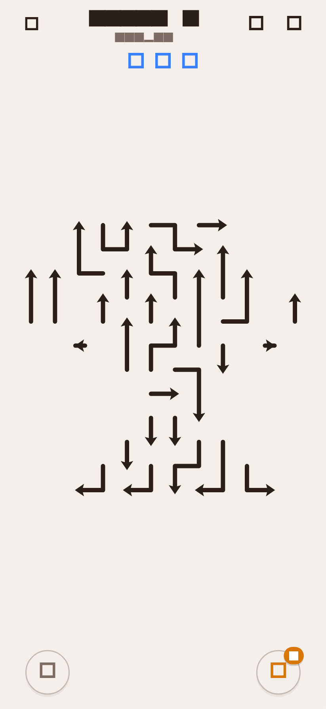

# Arrow Flow 🏹

An original, minimalist line-arrow puzzle game built in Flutter & Dart for Android. **Arrow Flow** features an elegant, calming aesthetic where the board consists solely of thin continuous lines forming recognizable object silhouettes.



---

## 🎨 Visual Aesthetics & Design

- **Pure Line-Arrow Board**: There are **NO boxes, tiles, or cells drawn**. The entire puzzle board consists strictly of thin continuous lines, 90-degree rounded turns, tail caps, and crisp arrowheads.
- **Silhouette Form**: Lines are packed densely and tightly so that, seen together, they form a recognizable silhouette (Trophy on Level 1, Anchor, Heart, Star, Cat, Fish, Butterfly, Rocket, etc.).
- **Themes**:
  - 🌿 **Eye Comfort** (Default): Warm cream/beige background (`#F5EFEB`) with dark brown lines (`#2C1E18`).
  - 🌙 **Dark**: Deep near-black background (`#14171E`) with soft luminous lines (`#7DD3FC`).
  - 📄 **Paper**: Crisp book white background (`#FAF9F6`) with charcoal lines (`#212529`).
  - 📜 **Sepia**: Vintage parchment (`#EFE2D0`) with rich umber lines (`#4A3425`).
- **HUD**:
  - **Top Bar**: Back button, Level title & silhouette name, Theme Palette picker, Settings icon.
  - **Water Drops**: 3 blue water-drop lives (lost drops become faded/empty).
  - **Bottom Controls**: Circular Grid-Toggle button (shows/hides faint background dot grid) and circular Hint button with an active badge counter.
- **Zoom & Pan**: Fully centered board with `InteractiveViewer` supporting pinch-to-zoom and pan for intricate levels, with double-tap to reset.

---

## 🎯 Core Mechanics

1. **Snake-Arrow Paths**: Each arrow is an ordered sequence of contiguous grid cells (tail to head). The head has a straight direction continuing out from its final segment.
2. **Escape Ray Check**: An arrow can escape only if the straight ray from its head cell, in its pointing direction, crosses no cells occupied by other remaining arrows.
3. **Fluid Slide-Out Animation**: When tapped, an unblocked arrow slides out smoothly along its own body trail and off the board using Flutter's `PathMetrics`, accompanied by a gentle whoosh and light haptic feedback.
4. **Obstacle Collision**: Tapping a blocked arrow deducts 1 water drop, shakes the arrow, flashes the blocking arrow in red, and plays an error tone with haptic response.
5. **Level Fail & Revive**: If all 3 water drops are lost, a "Level Failed" dialog offers Retry or Watch Ad to Continue (+2 Drops).
6. **Win Screen**: When all arrows are cleared, the completed silhouette outline is revealed with stars (⭐⭐⭐ for 0 mistakes, ⭐⭐ for 1, ⭐ for 2) and a Next Level button.
7. **Hold Guidance**: Long-pressing anywhere on the board highlights all currently unblocked arrows in guidance green.
8. **Generous Hit-Testing**: Evaluates distance from touch to nearest snake polyline segment within a comfortable tolerance (`cellSize * 0.58`), making taps responsive and effortless on mobile screens.

---

## 🧠 Silhouette Level Generation & Guaranteed Solvability

1. **Silhouette Mask Library**: Over 40 handcrafted silhouettes (Trophy, Anchor, Heart, Star, Cat, Fish, Tree, Crown, Butterfly, Rocket, etc.) encoded as 2D boolean masks.
2. **Random-Walk Path Partitioning**: Every active cell of the silhouette mask is covered by a snake-like path with 90-degree turns using Warnsdorff-inspired heuristics. 100% mask cell coverage with zero gaps or overlaps.
3. **Acyclic Dependency Orientation**: Head directions are oriented outward with intelligent cycle-breaking and head-flipping algorithms, ensuring a valid monotone removal order exists.
4. **Deterministic Generation**: Every level is deterministically derived from its level number (`seed = levelNumber`), generating smoothly across 300+ levels from $12 \times 12$ up to $36 \times 36$ grids offline.
5. **Built-in Solver**: Topological peeling solver verifies that every generated level is 100% solvable and powers optimal hints.

---

## 📁 Architecture & File Structure

```
arrow_flow/
├── android/                   # Native Android configuration (portrait locked)
├── assets/
│   └── audio/                 # Sound effects (whoosh.wav, tap.wav, error.wav, win.wav)
├── lib/
│   ├── logic/
│   │   ├── game_constants.dart    # Timings, drop counts, and ad frequencies
│   │   ├── level_generator.dart   # Deterministic silhouette generator & cycle repair
│   │   ├── move_validator.dart    # Straight escape raycasting & obstacle detection
│   │   ├── path_partitioner.dart  # 100% random-walk path cover of silhouette masks
│   │   ├── shape_library.dart     # 40+ iconic silhouette masks (Level 1: Trophy)
│   │   └── solver.dart            # Topological peeling solver & hint generator
│   ├── models/
│   │   ├── arrow.dart             # Snake polyline model (tail, head, cells, direction)
│   │   ├── board.dart             # Fast 2D lookup matrix & immutable state
│   │   ├── direction.dart         # Cardinal vectors, rotations & offsets
│   │   ├── level.dart             # Level metadata, dimensions & mask
│   │   └── shape_mask.dart        # 2D boolean mask & resampling logic
│   ├── services/
│   │   ├── ads_service.dart       # Monetization abstraction (interstitials, rewarded)
│   │   ├── audio_service.dart     # Audio playback & haptic feedback with test mode
│   │   └── storage_service.dart   # SharedPreferences for progress, themes & settings
│   ├── state/
│   │   ├── game_controller.dart   # Riverpod controller managing interactions & animations
│   │   ├── game_state.dart        # Immutable game state model
│   │   └── providers.dart         # Dependency injection providers
│   ├── theme/
│   │   ├── app_colors.dart        # UI palette accents
│   │   ├── app_theme.dart         # Material 3 theme data
│   │   └── game_theme.dart        # Eye Comfort, Dark, Paper, and Sepia themes
│   ├── ui/
│   │   ├── dialogs/               # WinDialog, FailDialog, HintRewardDialog
│   │   ├── screens/               # GameScreen, HomeScreen, SettingsScreen
│   │   └── widgets/               # BoardPainter, BoardWidget, WaterDrops, Outline
│   └── main.dart                  # Application entrypoint & Riverpod ProviderScope
└── test/
    ├── logic/
    │   ├── level_generator_test.dart  # Solvability verification across levels
    │   ├── move_validator_test.dart   # Raycast validation tests
    │   ├── path_partitioner_test.dart # 100% mask coverage verification
    │   └── solver_test.dart           # Solution ordering and cycle tests
    ├── gameplay_test.dart             # Complete interactive gameplay test
    ├── screenshot_test.dart           # Trophy silhouette snapshot test
    └── widget_test.dart               # App smoke test
```

---

## 💰 Monetization Integration Guide

The game includes a production-ready `AdsService` abstraction (`lib/services/ads_service.dart`):
- **Interstitial Cadence**: Displayed every 3 completed levels, never before level 5, never during active gameplay. Bypassed if ads are removed.
- **Rewarded Ads**: Available on demand for +2 hints or to revive upon losing all water drops.

### Plugging in `google_mobile_ads`:
1. Add `google_mobile_ads: ^5.2.0` to `pubspec.yaml`.
2. Add your AdMob App ID to `android/app/src/main/AndroidManifest.xml`:
   ```xml
   <meta-data
       android:name="com.google.android.gms.ads.APPLICATION_ID"
       android:value="ca-app-pub-################~##########"/>
   ```
3. In `lib/services/ads_service.dart`, connect `InterstitialAd.load()` and `RewardedAd.load()` in place of mock triggers.

### Plugging in `in_app_purchase`:
1. Add `in_app_purchase: ^3.2.0` to `pubspec.yaml`.
2. In `lib/services/ads_service.dart`, link `InAppPurchase.instance.buyNonConsumable()` for product ID `remove_ads`.
3. Call `await _storageService.setAdsRemoved(true)` upon transaction approval.

---

## 🚀 Running & Building

### ⚡ One-Click Local Run (Recommended)
You can launch the game locally in a standalone portrait mobile window (430x932) with a single click:
- **Windows Batch**: Double-click `run_local.bat` or run:
  ```cmd
  run_local.bat
  ```
- **PowerShell**:
  ```powershell
  .\run_local.ps1
  ```
  *(Or with mode parameters: `.\run_local.ps1 -Mode debug` for hot-reload, `.\run_local.ps1 -Mode test` for unit tests)*

### 🛠️ Flutter Development (Live Hot-Reload)
Run Flutter directly against Chrome:
```bash
flutter run -d chrome
```

### 🧪 Run All Unit and Integration Tests
```bash
flutter test
```

### 🔍 Static Analysis
```bash
flutter analyze
```

### 📱 Build Production Android APK
```bash
flutter build apk --release
```

